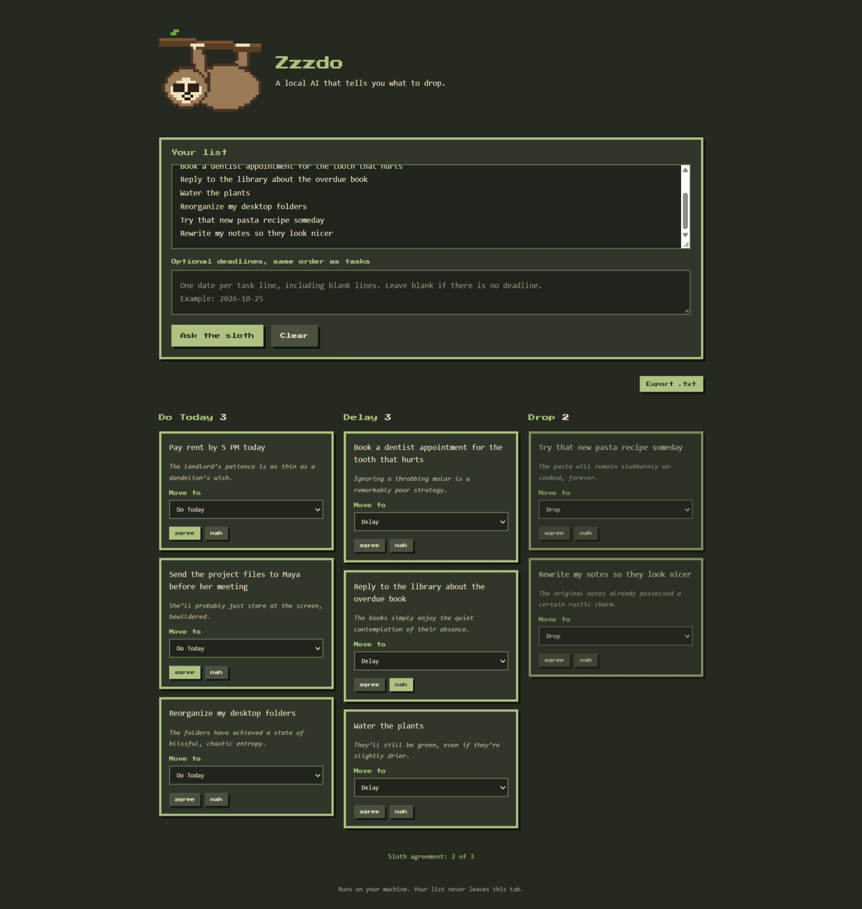
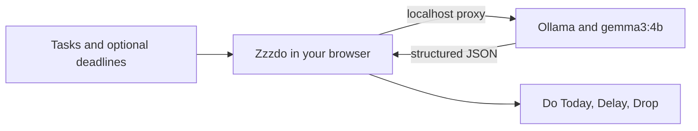

# Zzzdo

<p align="center">
  A local AI that tells you what to drop.<br>
  Paste a list. Let a pixel sloth sort it into Do Today, Delay, and Drop.
</p>

<p align="center">
  
</p>

<p align="center">
  
</p>

## Features

- Sorts each task into **Do Today**, **Delay**, or **Drop**.
- Uses optional deadlines as context without changing task text.
- Lets you move tasks between lanes. Do Today stays capped at three.
- Saves one **agree** or **nah** vote per task and shows the agreement count.
- Exports the sorted list and reasons as `zzzdo-results.txt`.
- Remembers your task list, deadlines, and votes in this browser.

### The three lanes

| Lane | How the sloth uses it |
| --- | --- |
| **Do Today** | A real deadline, person waiting, or consequence. Maximum three tasks. |
| **Delay** | It matters, but waiting causes no immediate trouble. |
| **Drop** | Nobody will notice if it never happens. |

## Run it locally

You need [Node.js](https://nodejs.org/) and [Ollama](https://ollama.com/) installed.

In one terminal, start Ollama:

```sh
ollama serve
```

In another terminal, install the model and start Zzzdo:

```sh
ollama pull gemma3:4b
npm install
npm run dev
```

Open the local URL printed by Vite.

## Add deadlines

Enter one task per line. In the optional deadlines box, enter a deadline on the matching line. Keep blank lines in the same positions when a task has no deadline.

```text
Pay rent
Send the files to Maya
Water the plants
```

```text
Today at 5 PM
Before Maya's 3 PM meeting

```

Deadlines are sent to the local Ollama model as context. They are not appended to task names.

## How it runs



The Vite development server proxies Ollama requests through `localhost:11434`. The app has no backend, cloud API, account, analytics, or API key. The model runs on your machine. Task text, deadlines, and votes are stored in this browser's local storage. **Clear** removes them.

## Model choice

Zzzdo uses `gemma3:4b` by default. Set `VITE_OLLAMA_MODEL` to use another model already available in Ollama.

PowerShell example:

```powershell
$env:VITE_OLLAMA_MODEL = "llama3.2:3b"
npm run dev
```

## Keeping the model honest

Ollama returns structured JSON. Zzzdo matches verdicts to the original tasks, drops invented items, restores missing tasks to Delay, and limits Do Today to three. You can change lanes yourself when the sloth misjudges one.

The agreement count is the number of **agree** votes out of all tasks with a vote. You can change a vote at any time. The exported text file includes each lane, task, and reason.

## Troubleshooting

If Zzzdo cannot reach Ollama, start the Ollama service and pull the default model:

```sh
ollama serve
ollama pull gemma3:4b
```

If you selected a different model with `VITE_OLLAMA_MODEL`, pull that model instead.

## Known limits

A small model can misjudge urgency, especially when a task lacks context. Deadlines can help, but Zzzdo is not a calendar or a reminder service.
